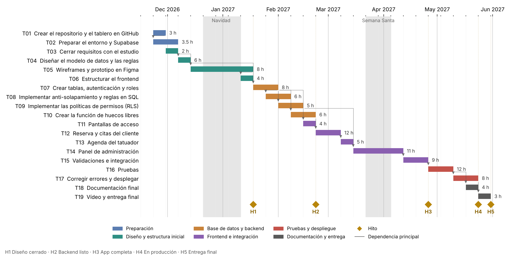

# Cronograma

Total: 119,5 h en 22 semanas útiles (6 h/semana, 23/11/2026 a 28/05/2027).

## Hitos
- **H1** Diseño cerrado: 15/01/27
- **H2** Backend listo: 19/02/27
- **H3** App completa: 23/04/27
- **H4** En producción: 21/05/27
- **H5** Entrega final: 28/05/27

## Tareas

| ID | Predecesoras | Horas | Inicio | Fin | Rol | Recursos |
|---|---|---|---|---|---|---|
| T01 | — | 3 | 23/11/26 | 27/11/26 | Sistemas / DevOps | GitHub, Git |
| T02 | T01 | 3.5 | 23/11/26 | 04/12/26 | Sistemas / DevOps | MacBook, VS Code, Supabase |
| T03 | — | 2 | 30/11/26 | 04/12/26 | Jefe de proyecto | Reunión con el estudio |
| T04 | T03 | 6 | 07/12/26 | 11/12/26 | Desarrollador backend / BD | FigJam, PostgreSQL |
| T05 | T03 | 8 | 14/12/26 | 15/01/27 | Diseñador UX/UI | Figma Education |
| T06 | T05, T02 | 4 | 11/01/27 | 15/01/27 | Desarrollador frontend | VS Code, Live Server |
| T07 | T04, T02 | 8 | 18/01/27 | 29/01/27 | Desarrollador backend / BD | Supabase, editor SQL |
| T08 | T07 | 6 | 25/01/27 | 05/02/27 | Desarrollador backend / BD | PostgreSQL |
| T09 | T07, T04 | 5 | 01/02/27 | 12/02/27 | Desarrollador backend / BD | Supabase |
| T10 | T07 | 6 | 08/02/27 | 19/02/27 | Desarrollador backend / BD | PostgreSQL |
| T11 | T06, T07 | 4 | 15/02/27 | 19/02/27 | Desarrollador frontend | supabase-js |
| T12 | T10, T11, T08 | 12 | 22/02/27 | 05/03/27 | Desarrollador frontend | supabase-js |
| T13 | T12, T09 | 5 | 08/03/27 | 12/03/27 | Desarrollador frontend | supabase-js |
| T14 | T09, T06 | 11 | 15/03/27 | 09/04/27 | Desarrollador frontend | supabase-js |
| T15 | T12, T13, T14, T08 | 9 | 12/04/27 | 23/04/27 | Desarrollador frontend | JavaScript, ESLint |
| T16 | T15 | 12 | 26/04/27 | 07/05/27 | Tester / QA | Navegadores, Lighthouse |
| T17 | T16 | 8 | 10/05/27 | 21/05/27 | Sistemas / DevOps | Netlify, Supabase, DNS |
| T18 | T16 | 4 | 17/05/27 | 21/05/27 | Jefe de proyecto | Markdown |
| T19 | T17, T18 | 3 | 24/05/27 | 28/05/27 | Jefe de proyecto | OneDrive, Aules |
